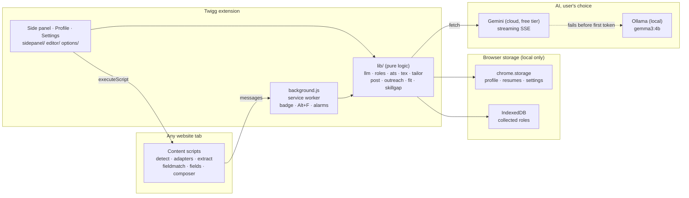
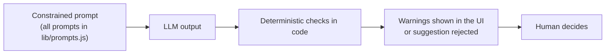

<div align="center">

# Twigg

### A job-hunt copilot that lives in your browser, knows your resume, and refuses to lie for you.

Autofill applications, track every role, tailor your resume to a job, and draft posts and outreach, all from a side panel in Chrome, Brave or Edge. **It never clicks Submit, Send or Post.** You stay in control.


-555)


</div>

---

## Why I built it

Applying for internships as a student is slow and repetitive:

- typing the same name, CGPA and 10th/12th marks into dozens of forms,
- opening 50 job pages and forgetting which ones fit and which deadlines are close,
- not knowing whether your resume matches a job's keywords,
- staring at a blank page for every cold email and LinkedIn post,
- tracking applications in your head.

The obvious fix, an auto-apply bot, makes things worse: it gets accounts flagged and sends wrong answers. Using an LLM naively has a subtler problem: **it invents things.** It adds a metric you never had or a tool you never used to your resume, and in a cold email it claims you read a professor's paper.

**Twigg does the repetitive work, and leaves every decision and every claim to you.**

---

## Highlights

| Feature | What makes it different |
|---|---|
| **Autofill** | Fills forms from your profile across frames (Alt+F) and colour-codes every field: green = from your profile, yellow = check it, red = needs you. It never submits, never ticks consent boxes, and never overwrites what you typed. |
| **Role collection** | Just browse. Twigg reads job, internship and hackathon pages you open (JSON-LD first, then per-site readers), filters them, and flags red flags such as application fees, WhatsApp-only applications or unpaid roles. |
| **Fit scoring + tracker** | An on-demand AI fit score (0–100 with strengths, gaps and eligibility), a Shortlisted → Applied → Interview → Offer pipeline, deadlines, follow-ups and browser reminders. |
| **Resume tailoring** | A weighted keyword match score, three *honest* gap lists, and AI bullet rewrites that are **validated in code**. A tailored `.tex` export changes only the bullets you approved and leaves everything else byte-for-byte identical. |
| **Posts and outreach** | LinkedIn drafts in *your* style, plus referral DMs, recruiter and professor emails, and follow-ups. Every draft is checked for invented numbers, names and claims. |
| **Skill-gap report** | Reads what your saved roles keep asking for, and separates real gaps from skills you have but didn't put on the resume. |
| **Private by design** | No Twigg server. All data lives in your browser. Contact details are never sent to the AI. Free to run (Gemini's free tier), with a fully local Ollama mode. |

---

## Architecture



**Layering:** browser APIs → `lib/` (pure functions, tested in Node without a browser) → content scripts → service worker → UI. Keeping the logic pure means it can be reused in both the service worker and the side panel, and tested in isolation.

### How the AI is kept honest



| Problem seen in real model runs | What Twigg does about it |
|---|---|
| A small model copied the JSON template back verbatim | Long writing uses **plain-text separators**; JSON is used only for short structured tasks |
| The model borrowed sentences from your sample posts | It never sends raw samples, only **measured style traits** (sentence length, casualness, emoji use, UK/US spelling) |
| Invented numbers, durations or plans ("the last few weeks") | Deterministic checks after generation flag anything not in your notes |
| Invented names, or "I read your paper" | Code checks names and claims against the page and your notes |
| A resume rewrite added a number or a tool | `validateRewrite()` **rejects** it: no new numbers, no new tools, no first person, no ballooning length |

> **Pattern:** constrain the prompt, check the output in code, show warnings, and let the human decide.

---

## Engineering decisions worth noting

| Decision | Why |
|---|---|
| **Plain JavaScript, no framework, no build step** | Load the folder and it works. Nothing to `npm install` and no bundler to break, under MV3's strict content-security rules. About 5,600 lines across 35 ES-module files. Trade-off: no TypeScript types and no React, which was right at this size. |
| **Stateless service worker** | MV3 shuts the worker down after ~30 s idle. Nothing important lives in memory: state is in storage, and timers use `chrome.alarms`, which wake the worker back up. |
| **Gemini → Ollama failover only before the first token** | Switching models after text has streamed would show two half-answers. The fallback chain also retries busy or retired Gemini models before switching. |
| **JSON-LD first, then per-site adapters** | schema.org `JobPosting` data is clean and stable. When a site has none, a small adapter per site means a redesign breaks one reader, not the whole extension. |
| **React-safe autofill** | Setting `.value` doesn't update React or Angular state. Twigg calls the native value setter, then dispatches real `input`/`change` events. Options match by whole words, so "Male" never matches "Female". |
| **Byte-identical LaTeX edits** | Bullets are spliced in by position with a brace-balance check. The preamble, headings and dates are never touched. |
| **Canonical role IDs** | The same posting seen through different URLs is stored once (e.g. `linkedin:<id>`). The same company and title on another site shows "Already applied elsewhere". |
| **Untrusted page content** | Page data is rendered with `textContent`, never `innerHTML`. |
| **Nothing expensive runs automatically** | AI scoring and writing run only when you click, so the free quota isn't wasted. |

---

## Testing, and what is honestly still unverified

- **Unit tests (Node):** field matching (51 label cases), stipend/duration/deadline parsing, filters and red flags, LaTeX parsing/editing, keyword scoring, rewrite validation, post/outreach checks, skill-gap math.
- **Browser tests:** a real Brave instance with the extension loaded, driven by puppeteer-core. They ran against saved snapshots of real pages (Naukri, Indeed, Unstop, Greenhouse, a GitHub repo), reconstructed login-only pages, mock forms (including iframes), and a **fake AI server** so the tests are fast, free and repeatable. **About 190 browser checks**, all passing at the end of development.
- **Real-model runs** for autofill, resume import, fit scoring and posts. These found the problems in the table above, and they were fixed.

Not verified live: LinkedIn's real post box and signed-in pages, Internshala single-job pages, Lever/Workday/hackathon sites, Google Forms on live pages, and compiling the tailored `.tex` (checked structurally only). The test scripts are not in this repository yet.

---

## Tech stack

**JavaScript (ES modules)** · **Chrome Extension Manifest V3** (service worker, content scripts, side panel, `scripting`, `alarms`, `notifications`) · **chrome.storage + IndexedDB** · **Google Gemini API** (streaming SSE, model fallback) · **Ollama** (`gemma3:4b`, NDJSON streaming) · **pdf.js** (vendored) · **LaTeX** · **schema.org JSON-LD** · Dev/test: **Node 22, puppeteer-core**

No server, no database server, no framework, no runtime npm dependencies.

---

# User guide

## 1. Install the extension (2 minutes)

1. Open `brave://extensions` (Chrome: `chrome://extensions`, Edge: `edge://extensions`).
2. Turn on **Developer mode**.
3. Click **Load unpacked** and select the `Twigg/extension` folder.
4. Pin Twigg to the toolbar. Click the icon or press **Alt+T** to open the side panel.

After changing any Twigg code, press the reload button on its card in `brave://extensions`.

## 2. Set up the AI

### Gemini (recommended, free)
1. Go to <https://aistudio.google.com/apikey> and create an API key (newer keys start with `AQ.`, older ones with `AIza`).
2. Paste it in Twigg settings (⚙), choose **Gemini only**, press **Save settings**, then **Test Gemini**. The default model is `gemini-3.5-flash`.
3. Google retires and overloads models often. If the chosen model is retired, busy or silent for 25 s, Twigg automatically tries `gemini-3.5-flash`, `gemini-flash-latest` and `gemini-flash-lite-latest` before giving up. A wrong key fails straight away with a clear message.

> On the free tier, Google may use prompts to improve its products. Twigg never sends your phone, email, address, DOB or roll number to the AI. Use **Ollama only (private mode)** for anything sensitive.

### Ollama (local, private)
Ollama blocks browser extensions by default. Run this once in PowerShell:

```powershell
setx OLLAMA_ORIGINS "chrome-extension://*"
```

Then **quit Ollama from the system tray and start it again**. The setting only applies to newly started processes.

Recommended model for a CPU-only laptop: `gemma3:4b`. In settings, click **Test Ollama**.

## 3. Add your resume (and update it any time)

Click 👤 in the side panel (or ⚙ → *Open profile & resume*). You can keep **one resume per role** (up to 4), e.g. "AI Engineering" and "Edge AI":

1. Type which role the resume is for, then **Upload PDF** (attached to "upload resume" fields) and **Upload .tex** (used for tailoring).
2. Twigg **reads the file straight away** and fills in what that resume shows (skills, projects, experience…) plus your shared details. Everything it filled is **highlighted in yellow**. Check it, then press **Save**. Nothing is saved before that.
3. **+ Add another resume** for your next role. Each resume keeps its own projects and skills; the rest of Twigg (chat, fit scores, posts, outreach) uses everything from all of them.
4. In **About you** (shared by every resume), fill the rest once: date of birth, 10th/12th %, address, preferences. Leave a field empty if it doesn't apply. Twigg never guesses it.

When a resume changes, upload the new file on its card (**Replace PDF**). If the browser can't save (for example, your disk is full) you get a clear message saying so. Use **Export backup** to keep a copy or move your data to another browser.

## 4. Autofill

Open an application form, then **Fill** tab → **Fill this page** (or press **Alt+F**).

- **Green** = filled from your profile · **yellow** = check it (AI-written, converted, or a guessed date format) · **red** = needs you.
- Click an item in the list to jump to that field.
- Fills what your profile answers directly; only the leftovers go to the AI, in one request.
- Skips fields that already have text (tick *Overwrite* to change that).
- **Resume uploads:** with one resume, its PDF is attached. With two or more, Twigg **asks every time**: the upload field stays red and the Fill tab shows *"Which resume should I attach?"*. Pick one and press **Attach**.
- Multi-page forms (Workday etc.): click Next yourself, then Fill again.
- After you fill the red fields yourself, click **Remember my answers** so Twigg reuses them next time.

Known limits: custom dropdowns (react-select style) and sites that block file uploads are left for you and shown red. Google Forms support is tested on a model of its structure, not yet on live forms.

## 5. Roles & tracker

Just browse. When you open a job, internship or hackathon page, or a search results page, Twigg reads what is already on it (nothing is crawled, nothing leaves your laptop) and saves it under **Roles**. The toolbar badge shows how many matches the page has (`!` = you already applied to it).

- **Matches / Maybe / Skipped**: your filters decide. Open **Filters** to set keywords (defaults cover AI / ML / edge / embedded / vision…), words to skip (sales, marketing…), minimum stipend, maximum duration, locations, remote-only and your graduation year. Changing filters re-checks everything saved.
- **Red flags** are shown on the card: asks for a fee (auto-skipped), asks you to apply via WhatsApp/Telegram, unpaid, performance-only pay, hidden company, deadline passed, a posting that names a batch that isn't yours.
- **Rate fit** (per role, or "Rate fit for matches" for a few at a time): the AI compares the posting with your profile and gives a 0–100 score, strengths, gaps and eligibility. It only runs when you ask, so the free Gemini quota isn't wasted.
- **Shortlist** the ones you care about (they get deadline reminders). **Applied** moves one to the **Tracker** with a follow-up date 7 days out.
- **Tracker**: status (Shortlisted → Applied → Online test → Interview → Offer / Rejected), deadline, follow-up date, notes. A "Coming up" box lists deadlines and follow-ups due soon. Browser notifications fire once per deadline (shortlisted roles only) and once per follow-up.
- **Duplicates**: the same company + title seen on another site after you applied shows "Already applied elsewhere".
- Turn **Collect roles as I browse** off if you'd rather save pages by hand (the "On this page" card has Save buttons). **Export CSV** gives you a spreadsheet.

| Site | List pages | Single-job pages | Checked against |
|---|---|---|---|
| Naukri | yes | yes (structured data) | real page snapshot |
| Indeed | yes | yes (structured data) | real page snapshot |
| Unstop (jobs, internships) | yes | yes (structured data) | real page snapshot |
| Greenhouse boards | yes | yes | real page snapshot |
| LinkedIn (signed out) | yes | yes (structured data) | structure observed live, test page reconstructed |
| LinkedIn (signed in) | best effort | best effort | not tested; selectors are guesses |
| Internshala | yes (cards) | DOM reader | list structure observed live; detail page **not verified** |
| Y Combinator jobs (ycombinator.com/jobs) | yes (title, company, type, place, yearly salary) | best effort | real page snapshot |
| Work at a Startup (workatastartup.com) | yes | yes | public pages observed live (jobs list, company page, job page); the signed-in search layout is **reconstructed from a screenshot, not tested live** |
| Lever, Workday, hackathon sites (Devfolio, Kaggle, MLH…) | best effort | best effort | not tested on live pages |
| Any other site | — | yes, if it publishes standard JobPosting data | — |

Sites change their markup without notice. If a page shows no roles:

1. Open the **Roles** tab and press **Scan this page** (it also scans automatically when you open the tab). Twigg only reads pages loaded after it starts, so scanning handles tabs that were already open.
2. If it still finds nothing, press **Copy page details (no personal info)**. That copies only the page's link patterns and layout (no names, text or personal data), which is what you need to teach Twigg the layout. Open an issue with it, or add a reader in `extension/content/adapters.js`. Many sites need only a few lines there.

## 6. LinkedIn posts

**Post** tab → pick a type (project launch, joined an internship, certificate, hackathon, learning milestone, research, other) → type rough notes → **Write 2 drafts**.

- Twigg only uses facts from your notes (and the page, if you tick *Also use this page* on a GitHub repo, project or certificate page). The AI is told never to invent numbers, results, durations or plans, but AI models do it anyway, so **read every draft before posting**. Twigg underlines the risk: if a draft contains a number, a time span ("the last few weeks"), a future plan or a word like "significantly" that isn't in your notes, a yellow note lists it above the Insert button.
- Drafts copy *how* you write, not *what* you wrote. Twigg measures your writing samples on your own machine (sentence length, casualness, emojis, British/American spelling) and sends only that short description to the AI, never the posts themselves. Small models otherwise borrow details from samples. Add 2–3 of your own posts to your profile for the best match.
- The small local model (`gemma3:4b`) follows the rules less strictly than Gemini does. For posts, Gemini gives noticeably more faithful drafts.
- Tweak chips: Shorter, More casual, Stronger opening, End with a question.
- **Insert into LinkedIn** types the draft into the "Start a post" box (opening LinkedIn first if you're elsewhere) and also copies it. **It never presses Post.** If LinkedIn's page changes and the box can't be found, you get the copy and a Ctrl+V hint. It never overwrites text already in the box.
- Your notes and drafts are kept if you close the panel.

## 7. Tailor your resume for a job

First upload your **.tex** in your profile (👤). Then open a job page (or pick a saved role, or paste a description) → **Tailor** tab → **Check my resume for this job**.

- **Match score**: which skills and tools the job asks for, weighted (things under "Requirements" count more than "Nice to have"; repeated mentions count more), compared with your resume. It is a guide, not a promise: real applicant-tracking systems differ.
- **Three honest lists.** *Already on your resume* · *On your profile, missing from your resume* (you list these yourself, so you can honestly add them; **Copy "add to Skills" line**) · *Not on your profile* (real gaps; Twigg never offers to add these).
- **Suggest bullet rewrites**: the AI may only *reword* bullets you already wrote, using the job's vocabulary. Each suggestion is checked in code and thrown away (shown unticked with the reason) if it adds a number, adds a tool the original bullet didn't mention, switches to first person, or balloons in length. You can edit any suggestion; its warning updates as you type.
- **Build tailored .tex**: only the bullets you ticked change. Your preamble, headings, dates, skills and anything you commented out are left byte-for-byte as they were. Then **Download .tex** and upload it to Overleaf for the PDF. Always check the PDF before sending it.
- Works with Jake's Resume and similar templates (`\resumeItem{…}` and plain `\item` lines). A reworded bullet loses inline bold/links *inside that one bullet*.
- No .tex yet? It still scores your profile against the job; bullet rewrites need the .tex.

## 8. Outreach drafts

**Outreach** tab → pick the kind of message: *Referral request* (LinkedIn message), *Connection note* (300-character limit), *Cold email to a recruiter*, *Research internship email to a professor*, or *Follow-up* after applying.

- Optionally pick a **saved role** (the follow-up uses the real date you applied) and tick **Use this page** on the person's LinkedIn profile, faculty page or company page. Add a line about what you want.
- Twigg writes one draft. For emails it fills **To** *only* if the page itself shows an address (a `mailto:` link). **It never guesses an email address.**
- It's a draft, not a send: **Copy**, or **Open in Gmail** (a compose window with the subject and body; you add the recipient if blank and press Send).
- Every draft is checked in code, and a yellow note lists what to fix before you send: leftover `[Name]`-style placeholders, a greeting name that isn't on the page or in your notes, generic flattery ("big fan"), claiming you *read their paper* when you didn't say so, a number or time span you never gave, a connection note over 300 characters, a missing subject. Small AI models make these mistakes often in cold messages, so read it and check every name before sending.
- Chips: Shorter, Warmer, More direct (the warnings are re-checked on the new text). Your draft survives closing the panel.

### Skill gaps

In the **Roles** tab, **Skill gaps** reads the skills that your saved roles (full postings, not just search-result stubs) keep asking for and shows how many roles mention each one:

- **Missing (not on your profile)**: asked for often, but you list it nowhere. Don't claim it; learn or build something.
- **On your profile, not on your resume** (when a .tex is stored): you can honestly add these.
- **Already on your resume / profile.**
- **Suggest projects for my top gaps** (AI): small 1–2 week project ideas that build on your existing work, each with a phrase for how to show it once you've done it. These are things to *do*, never claims.

It needs at least 3 saved roles with enough detail to read skills from.

## Project layout

```
extension/
  manifest.json        MV3 manifest
  background.js        service worker (Alt+F, role saving, reminders)
  lib/                 llm.js (Gemini + Ollama), autofill.js, profile.js, resume-import.js, prompts.js, settings.js,
                       roles.js (parsing, filters, red flags), store.js (IndexedDB), page-roles.js, fit.js (AI rating), reminders.js,
                       post.js, tex.js + ats.js + tailor.js (resume tailoring), outreach.js, skillgap.js
  content/             page scripts: extract.js, adapters.js + detect.js (role collection), fieldmatch.js + fields.js (autofill), composer.js (LinkedIn post box)
  sidepanel/           the side panel: Chat, Fill, Roles (+ skill gaps), Tracker, Post, Tailor, Outreach
  editor/              profile & resume page
  options/             settings page
  ui/                  shared theme, markdown renderer, form editor
  vendor/pdfjs/        PDF reader (Apache-2.0)
  profile/profile.json blank starting template (your data lives in the browser, not here)
```

For a full walkthrough of how it works, written for newcomers, read [PROJECT_GUIDE.md](PROJECT_GUIDE.md).

## Privacy and your API key

- Everything Twigg stores (your profile, resumes, saved roles, drafts and settings) lives in this browser (`chrome.storage` and IndexedDB). There is no Twigg server.
- **Your Gemini API key is stored only in your browser's extension storage.** It is never written to a file in this project, so it cannot end up in Git. Never paste a key into source code, issues or chat; if you ever do, delete it at <https://aistudio.google.com/apikey> and create a new one.
- Twigg never sends your phone number, email, address, date of birth or roll number to the AI (autofill fills those locally). The one exception is *resume import*, which has to send your resume text to the AI once so it can read it. Use Ollama-only mode if that matters to you.
- It never submits a form, presses LinkedIn's Post button, sends an email, or ticks a consent box. You do the final click.

## Project status and limits

All seven planned phases are built. It was developed and tested in Brave against saved copies of real job pages and mock forms. Most AI output was checked with a fake AI server and some with a small local model (`gemma3:4b`), so wording quality with Gemini is less tested. See *Testing* above for what is not verified live.

Bundled third-party code: [pdf.js](https://github.com/mozilla/pdf.js) (Apache-2.0, `extension/vendor/pdfjs/`). No license has been chosen for Twigg's own code yet; add one (for example MIT) before accepting contributions.

## Troubleshooting

| Problem | Fix |
|---|---|
| "Ollama refused the extension (403)" | Set `OLLAMA_ORIGINS` (above) and restart Ollama |
| "Could not reach Ollama" | Start the Ollama app |
| Gemini 429 | Free-tier rate limit: wait a minute or switch to Ollama |
| Resume PDF gives "couldn't read any text" | It's a scanned image: upload the .tex or type details in |
| "Twigg can't read this tab" | Browser pages (`chrome://`, Web Store, PDF viewer) can't be read |
| Brave: Test buttons fail with a network error | Lower Shields (lion icon) on the Twigg settings page |
| Roles tab empty on a job page | Press **Scan this page** (see section 5). Tabs opened before Twigg was (re)loaded need a scan or a refresh |
| Gemini says a model "is no longer available" | Reload the extension (an old version is running) and set the model to `gemini-3.5-flash` in settings |

## Roadmap
- [ ] Commit the unit and browser test suites (`tests/`)
- [ ] Verify LinkedIn signed-in pages, Internshala detail pages, Lever and Workday live
- [ ] Choose a license
- [ ] Chrome Web Store listing

---

<div align="center">

Designed and built by **Soumya Sharma**, ECE @ BIT Mesra, building toward AI/ML engineering.<br>
Implemented with AI pair-programming. Every feature was designed, reviewed and tested by me.

**[GitHub](https://github.com/Swizknife)** · Also see **[postman-ln](https://github.com/Swizknife/postman-ln)**, which turns GitHub activity into fact-checked LinkedIn posts · Open to Summer 2027 AI/ML internships

</div>
